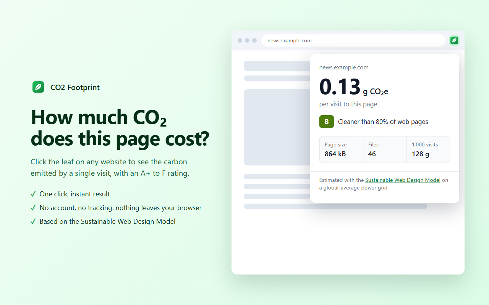

# CO2 Footprint

A Chrome extension: click it on any website to see how much CO2 one visit to that page puts into the atmosphere.



## What it costs

| Item | You | Your users |
| --- | --- | --- |
| Chrome Web Store developer registration | **$5, once** (never renews; covers updates and up to 20 extensions) | – |
| Servers, hosting, APIs, database | $0: there are none, everything runs in the browser | $0 |
| Libraries and build tools | $0: plain JavaScript, no dependencies | – |
| Domain and website | $0: not needed | – |
| Privacy policy hosting | $0: a free GitHub Gist (only if Google asks) | – |
| Icons, screenshots, store images | $0: generated in `store/` | – |
| Publishing updates | $0 | – |
| Installing and using it | – | $0, no account, no ads |
| Growth (10 users or 10 million) | $0: no backend, so nothing scales with users | – |
| **Total** | **$5 one-time, then $0 forever** | **$0** |

The $5 can't be avoided if you want to be on the Chrome Web Store. Every developer pays it. The free alternatives don't reach Chrome users the normal way: users can load the folder in developer mode, and Edge and Firefox have their own free stores.

## Go live today: step by step

About 30 to 45 minutes of your time, then Google's review.

### 1. Try it yourself (5 min)

1. Open `chrome://extensions` in Chrome.
2. Turn on **Developer mode** (top right).
3. Click **Load unpacked** and choose the `extension` folder.
4. Click the puzzle-piece icon in the toolbar and pin **CO2 Footprint**.
5. Open any website, wait for it to load, and click the leaf.

### 2. Turn on 2-Step Verification (2 min, skip if it's already on)

Google requires it to publish. Go to [myaccount.google.com/security](https://myaccount.google.com/security) and turn on **2-Step Verification**.

### 3. Register as a Chrome Web Store developer (10 min, $5)

1. Go to the [Chrome Web Store developer dashboard](https://chrome.google.com/webstore/devconsole) and sign in with that Google account.
2. Accept the developer agreement and pay the **$5** registration fee.
3. In **Account**, enter a publisher name (this is shown publicly) and verify your contact email. Publishing is blocked until the email is verified.
4. If it asks whether you're a **trader**: choose **non-trader** if you're publishing as an individual with no business behind it. This is an EU requirement.

### 4. Upload the extension (2 min)

Click **New item** and upload `dist/co2-footprint-1.0.0.zip`.

### 5. Fill in the listing (10 to 15 min)

Everything to copy and paste is in [`store/LISTING.md`](store/LISTING.md):

- **Store listing** tab: description, category, language, and the three images in `store/`.
- **Privacy** tab: single purpose, the two permission justifications, "no remote code", no data collected, and the three certifications.
- **Distribution** tab: Free, Public, all regions.

**Privacy policy URL:** the extension collects no data, so Google normally doesn't require one. If the form won't save without one:
1. Fill in your contact email in [`PRIVACY.md`](PRIVACY.md).
2. Paste the file into a new public gist at [gist.github.com](https://gist.github.com). It's free; name the file `privacy.md`.
3. Paste the gist's URL into the field.

### 6. Submit for review (1 min)

Click **Submit for review**. Leave **publish automatically after review** turned on so it goes live as soon as it's approved.

Google decides how long review takes and doesn't promise a time. Small extensions like this one often get through in less than a day, but it can take a few days. This one is set up for the quickest review: just two narrow permissions, no remote code, no data collection and no access to websites until the user clicks. When it's approved you get an email, and the extension's store page is live.

### Optional: Microsoft Edge (free, same zip)

Edge has its own store with no registration fee. Register at [Microsoft Partner Center](https://partner.microsoft.com/dashboard/microsoftedge), upload the same zip, and reuse the same text and images.

## Releasing an update

1. Change `"version"` in `extension/manifest.json` (for example `1.0.1`).
2. Run `python tools/package.py`.
3. In the dashboard, open the item → **Package** → **Upload new package** → **Submit for review**.

## How the number is calculated

1. **Bytes:** the popup reads the page's own Performance API (`navigation` and `resource` entries). Each file is counted once, at the size a first-time visitor downloads.
2. **Hidden files:** files from other domains that hide their size get a typical size for their type, from the HTTP Archive Web Almanac 2024. Unknown API calls and tracking pings are left out because they're usually tiny. The popup says when hidden files were estimated.
3. **CO2:** the [Sustainable Web Design Model v4](https://sustainablewebdesign.org/estimating-digital-emissions/), using the same constants as CO2.js:
   - 0.3 kWh per GB across data centres, networks and devices.
   - 494 g CO2e per kWh, the global average grid.
   - So 1 MB comes to about 0.15 g.
4. **Rating:** SWD v4 digital carbon ratings, from A+ (≤ 0.040 g, cleaner than 95% of pages) to F (above the median page, 0.359 g).

**Known limits:** content inside embedded frames (videos, ads) isn't counted, and Chrome only records the first 250 files of a page. The popup says when it hits that limit.

## Project layout

```
extension/   the extension itself (this is what gets zipped)
store/       store images and copy-paste listing text
dist/        the zip to upload
tools/       scripts: make_icons.py, make_store_assets.py, package.py
PRIVACY.md   privacy policy
```

To rebuild the icons or store images: `python tools/make_icons.py` or `python tools/make_store_assets.py` (both need Pillow; the second also needs Chrome).
